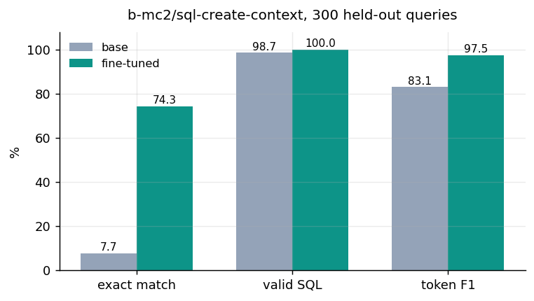
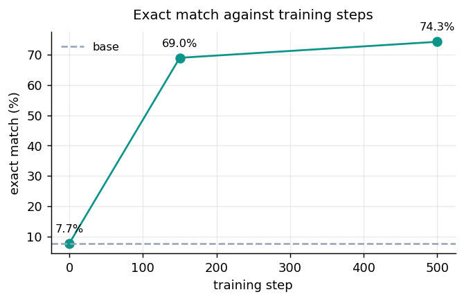
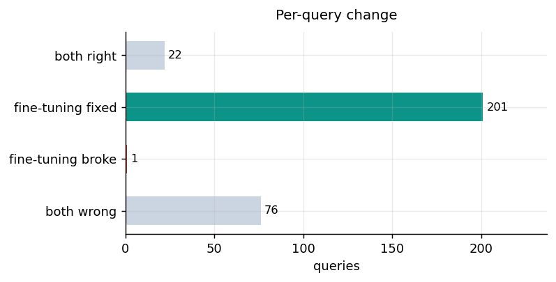
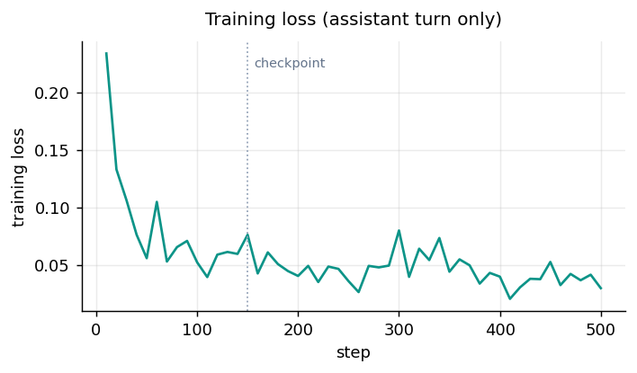

<p align="center">
  <a href="https://huggingface.co/emonHasan01/qwen2.5-3b-text2sql">
    
  </a>
  <a href="https://huggingface.co/Qwen/Qwen2.5-3B-Instruct">
    
  </a>
  
  
  
  
</p>


<div align="center">

[Hugging Face](https://huggingface.co/emonHasan01) | [GitHub](https://github.com/Md-Emon-Hasan) | [LinkedIn](https://www.linkedin.com/in/md-emon-hasan-695483237/) | [WhatsApp](https://wa.me/8801834363533) | [Portfolio](https://emonlabs-ai.hitechparks.com/)

**Author:** [Md. Emon Hasan](https://huggingface.co/emonHasan01)

</div>

# qwen2.5-3b-text2sql

**Qwen2.5-3B-Instruct turned into a SQL writer.** A 16-bit LoRA fine-tune trained with
[Unsloth](https://github.com/unslothai/unsloth) on
[`b-mc2/sql-create-context`](https://huggingface.co/datasets/b-mc2/sql-create-context).

Exact match rises from **7.7% to 74.3%** on 300 held-out queries,
a gain of **+66.6 points**.

## Results



| | exact match | valid SQL | token F1 | mean output chars |
|---|---|---|---|---|
| `unsloth/Qwen2.5-3B-Instruct` | 7.7% | 98.7% | 83.1 | 75 |
| **this model** | **74.3%** | **100.0%** | **97.5** | **75** |

**Exact match is computed on normalised ASTs, not strings.** Both queries are parsed with
[`sqlglot`](https://github.com/tobymao/sqlglot) and re-emitted in a canonical form, so
differences in case, whitespace and quoting do not count as errors.

**The same output cleaning was applied to both models** — markdown fences stripped, leading
prose removed, first statement taken. Without that the comparison would mostly measure
whether a model wraps its answer in backticks. The gain above is about the SQL being right.



Measured at three points: untrained, step 150, and step 500.

### Per-query, not just the aggregate



| | queries |
|---|---|
| both correct | 22 |
| only this model correct | 201 |
| only the base correct | 1 |
| neither correct | 76 |

### Samples

| Question | Reference SQL | Base correct | This model correct |
|---|---|---|---|
| How many Attendances have a Score of 4 – 5? Question 4 | `SELECT MAX(attendance) FROM table_name_88 WHERE score = "4 –` | no | no |
| When did woking compete? | `SELECT date FROM table_name_92 WHERE opponent = "woking"` | no | no |
| What is the local name given to the city of Canberra? | `SELECT capital___endonym__ FROM table_1008653_1 WHERE capita` | no | yes |
| What is the Version before 2001 with a Length of 7:42? | `SELECT version FROM table_name_64 WHERE year < 2001 AND leng` | no | yes |



## Usage

```python
from transformers import AutoTokenizer, AutoModelForCausalLM
import torch

tok = AutoTokenizer.from_pretrained("emonHasan01/qwen2.5-3b-text2sql")
model = AutoModelForCausalLM.from_pretrained("emonHasan01/qwen2.5-3b-text2sql", torch_dtype=torch.float16,
                                             device_map="auto")

schema = "CREATE TABLE head (age INTEGER, head_id VARCHAR)"
question = "How many heads of the departments are older than 56?"

messages = [
    {"role": "system", "content": "You convert questions into a single SQLite query. Reply with the query only: no explanation, no markdown, no commentary."},
    {"role": "user", "content": f"Schema:\n{schema}\n\nQuestion: {question}"},
]
prompt = tok.apply_chat_template(messages, tokenize=False, add_generation_prompt=True)
inputs = tok(prompt, return_tensors="pt", add_special_tokens=False).to(model.device)
out = model.generate(**inputs, max_new_tokens=128, do_sample=False)   # greedy
print(tok.decode(out[0][inputs["input_ids"].shape[1]:], skip_special_tokens=True))
```

**Use greedy decoding.** Sampling introduces column and table names that are not in the
schema. The system prompt and user template are in
[`prompt_format.json`](prompt_format.json) and were present in every training example.

## Training

| | |
|---|---|
| Base model | `unsloth/Qwen2.5-3B-Instruct` (3.1B parameters) |
| Method | LoRA at 16-bit via Unsloth |
| Trainable | 29,933,568 parameters (0.97%) |
| Rank / alpha / dropout | 16 / 16 / 0 |
| Target modules | `q,k,v,o,gate,up,down` |
| Learning rate | 0.0002, linear, `adamw_8bit` |
| Batch | 2 × 4 = 8 effective |
| Steps | 500 |
| Max sequence | 512 tokens |
| Peak VRAM | 6.9 GB of 15.0 |

### Why this task worked when a previous attempt did not

An earlier experiment distilled reasoning traces into Llama-3.2-3B and GSM8K accuracy
**fell** from 75.0% to 65.0%. That model had already been post-trained on maths by its
authors, leaving little headroom and plenty to disturb.

Fine-tuning pays off where the base model's output does not match the target **form**.
Asked for SQL, an instruct model returns a markdown fence, a preamble and an explanation,
and it reaches for columns the schema does not contain. Those are form errors, and they are
exactly what supervised fine-tuning fixes — which is why the gain here is +66.6 points
rather than a regression.

This model was only published because a gate in the training notebook required at least a
+5 point improvement over the baseline before uploading.

## Limitations

- **Single-table, synthetic schemas.** `sql-create-context` pairs one `CREATE TABLE` with
  one question. Multi-table joins, real production schemas, CTEs and window functions are
  out of distribution.
- **Exact match is strict and also too lenient.** It misses semantically equivalent queries
  written differently, and it credits queries that parse identically but would error against
  a real database. Nothing here was executed against actual data.
- **Evaluated on 300 queries**, so differences under a couple of points are noise.
- **No SQL injection or safety review.** Do not route model output straight into a database
  without validation and a read-only connection.
- **Greedy only.** Sampled decoding was not evaluated and hallucinates schema elements.
- A 3B model will not match a frontier model on hard SQL.

## Reproducing

Produced the baseline, both training stages, all four charts
and this card. Raw numbers in [`results.json`](results.json).
